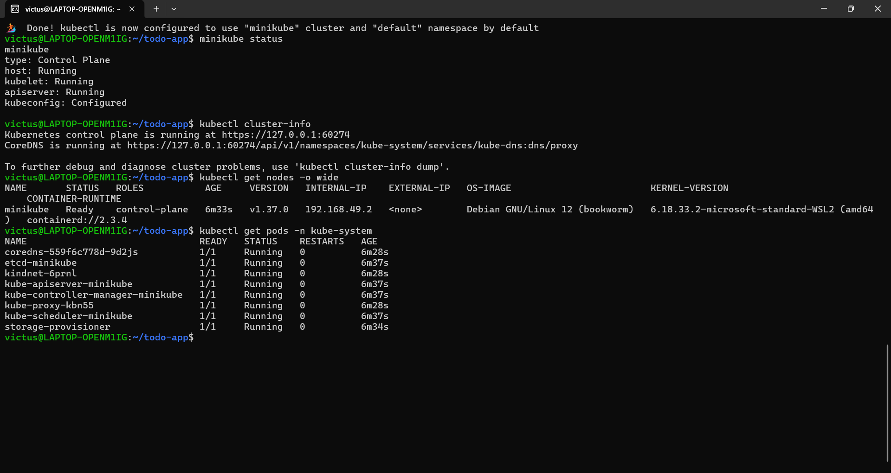
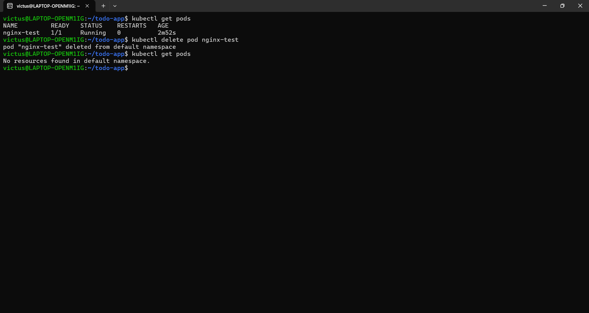
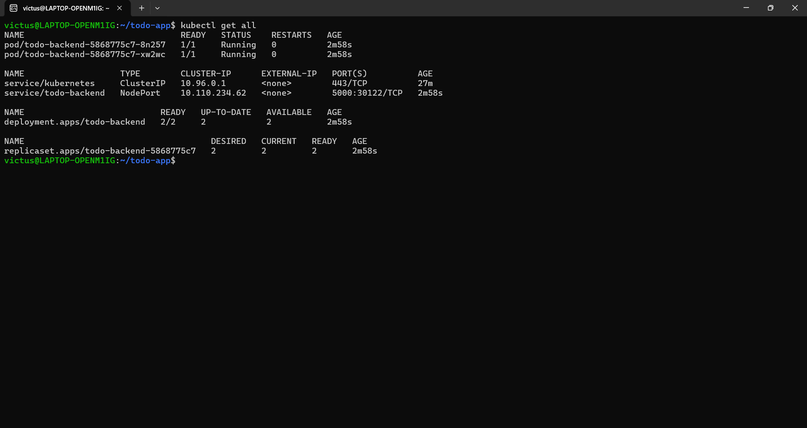
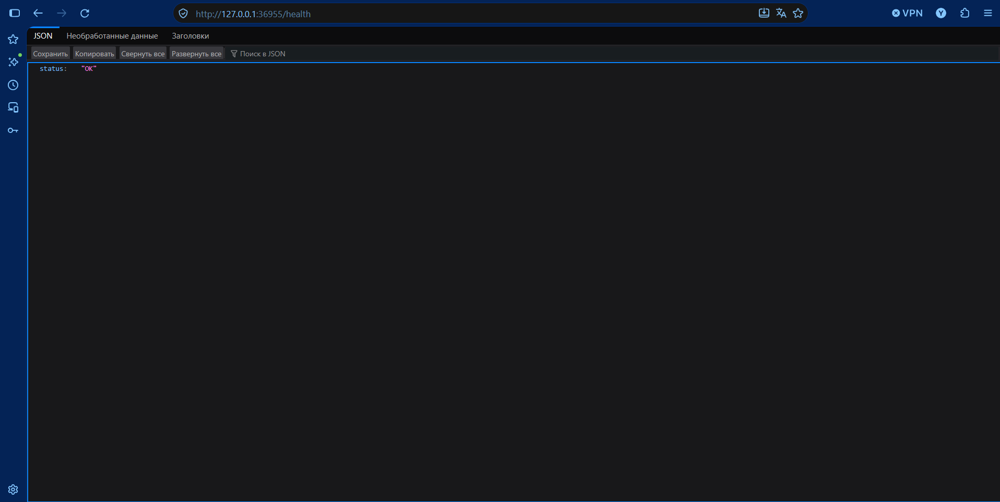
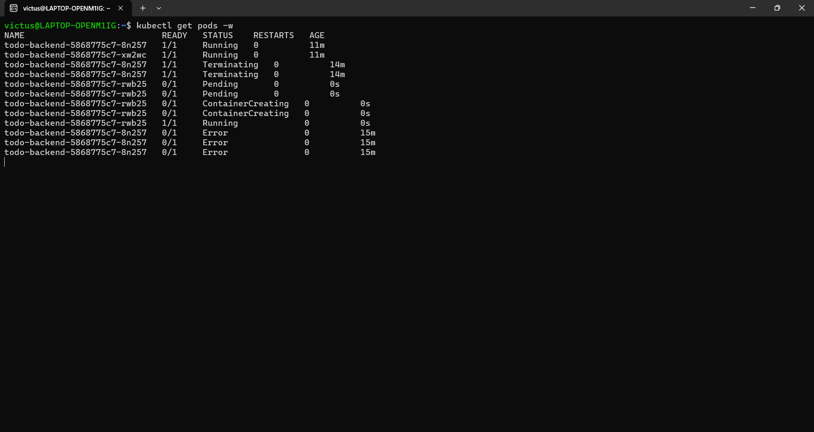

# Лабораторная работа 7 (часть 1). ToDo backend в minikube

## Задание 1. Запуск minikube и знакомство с кластером

Кластер minikube запущен с драйвером `docker`, проверены состояние узлов и системные Pod-ы в пространстве имён `kube-system`.

**Ответы на вопросы:**
1. **Сколько узлов в вашем кластере?** В кластере 1 узел (`minikube`) с ролью `control-plane`.
2. **Назовите 2–3 компонента control plane, которые вы видите в списке `kube-system`.** `kube-apiserver-minikube`, `kube-controller-manager-minikube`, `kube-scheduler-minikube` и `etcd-minikube`.

---

## Задание 2. Pod без Deployment: почему так не делают

Создан одиночный Pod `nginx-test` из манифеста `k8s/pod.yaml`, проверен его запуск, после чего Pod был удалён командой `kubectl delete pod nginx-test`.

**Ответ на вопрос:**
* **Появился ли Pod снова после удаления? Почему?** Нет, Pod не появился снова, так как он был создан напрямую без контроллера (Deployment / ReplicaSet), который отслеживал бы его состояние и восстанавливал при удалении.

---

## Задание 3. Backend в Kubernetes: Deployment + Service

Собран Docker-образ `todo-backend:1.0`, загружен в minikube и развёрнут через `k8s/backend.yaml` (Deployment на 2 реплики и Service типа `NodePort`).

Приложение открыто через туннель `minikube service todo-backend`, проверен эндпоинт `/health` — сервер вернул `{"status": "OK"}`.

---

## Задание 4. Самовосстановление

Запущено наблюдение `kubectl get pods -w`, после чего один из Pod-ов backend (`todo-backend-5868775c7-8n257`) был удалён вручную. Kubernetes автоматически создал новый Pod (`todo-backend-5868775c7-rwb25`) и довёл его до статуса `Running`.

**Ответы на вопросы:**
1. **Совпадает ли имя нового Pod со старым?** Нет, имя изменилось: вместо `todo-backend-5868775c7-8n257` создан новый Pod с уникальным суффиксом — `todo-backend-5868775c7-rwb25`.
2. **Кто создал новый Pod и почему? В чём отличие от задания 2?** Новый Pod создал контроллер ReplicaSet (управляемый через Deployment), чтобы поддерживать заданное количество реплик (`replicas: 2`). В отличие от задания 2, где одиночный Pod никем не контролировался, Deployment обеспечивает автоматическое самовосстановление.
